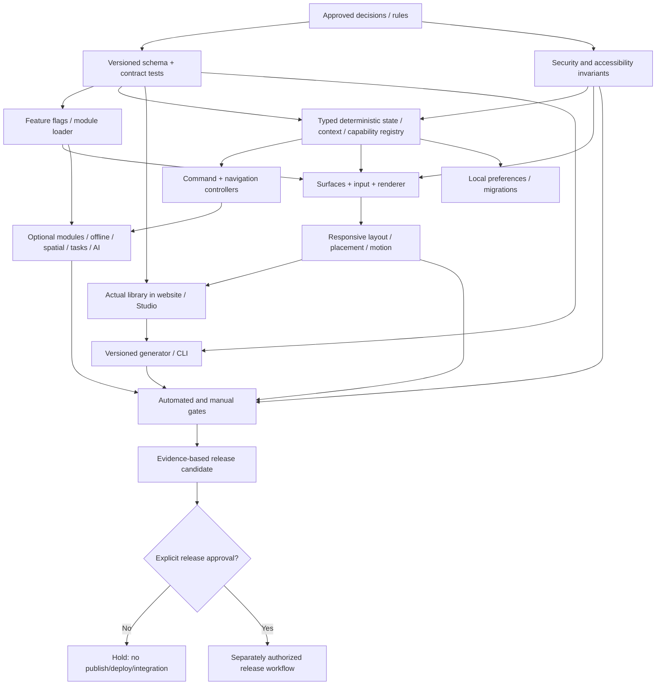

# Dependency map and architectural reconciliation

## Implementation dependency graph

## Resolved cross-decision tensions
| Tension | Resolution / invariant |
|---|---|
| One public package vs modular monorepo | Many private workspaces/fixtures; **one** distributable library package and modular exports |
| Framework-neutral runtime vs Next.js website | Portal may use Next.js; library core never requires Next.js/React |
| Simple default vs many advanced features | Progressive integration, optional imports and runtime flags, hosted Studio not prerequisite |
| Runtime flags vs bundle exclusion | Disabled means no work; unused bytes excluded only when build/import graph supports it; test both |
| CSP-first vs runtime styling/morphing | Validate CSS/WAAPI/stylesheet strategy under strict CSP before API freeze; fall back only to compliant implementation |
| Shadow DOM by default vs portals and framework adapters | Scoped mount/surface/focus contract tested for Shadow and Light DOM; no CSS escape by default |
| Fullscreen/container support vs fixed bottom positioning | Viewport fixed is default; explicit host mount context required for embedded/fullscreen cases |
| Spatial collision avoidance vs optional feature requirement | Basic safe areas always active; **host spatial coordination is independent and OFF by default**, no observers off |
| Host input priority vs `Ctrl/⌘+K` demo | Global shortcut registration opt-in; host delegation required when it owns a shortcut |
| Intelligent context vs no user-learning | Context only uses current host state and explicit preferences, never usage tracking/modeling |
| Automatic responsiveness vs stable focused actions | Interaction-stable composition; security revocation immediate even if visual transition deferred |
| Velocity-aware motion vs deterministic state | State is authoritative; motion merely interpolates and retargets to legal state |
| Local persistence vs federation | Namespaced per-project storage; no implicit inter-project sync |
| Task Center vs actual background execution | Host owns jobs; toolbar only presents registered job/task states |
| Optional offline queue vs command safety | Only explicit host-authorized, safe/idempotent, bounded, cancelable policies; never replay unsafe defaults |
| Extensions vs strong security isolation | Trusted extension SDK is capability-scoped **but not JS sandbox**; untrusted portal experiments require isolation |
| Versioned docs vs generated project upgrades | Shared schema/contracts/templates; manifests and preview-only non-destructive changes |
| Coverage gates vs exploratory prototypes | Each milestone has executable fixtures and test gates; may allow explicit evidence-backed exceptions where authorized |
| Agent autonomy vs approved decisions | Reversible internal choices autonomous; public behavior/security/release scope require user approval |

## Critical-path work
1. Inventory existing repository and record authoritative configuration/lockfile.
2. Draft and test schema, typed error/result/lifecycle, capability/context contracts.
3. Verify DOM isolation + CSP + focus/accessibility assumptions with thin integration prototypes.
4. Implement minimal dock/core without portal coupling, add tooling/gates.
5. Implement adapters/surfaces/input/placement/motion, then optional features.
6. Build portal against actual library; generator/CLI consume exact same contracts.
7. Run extended matrix, performance baseline and audits; release only after separate approval.

## Parallelization rules
Themes/motion UI can advance against mocked **contract fixtures** after schemas stabilize; do not invent second state engines. Documentation/Gallery can build alongside runtime only if examples compile against actual source. Optional modules can be developed in parallel once lifecycle/capability/permission contracts are stable. Generator should not predate stable config and framework adapter fixtures.
